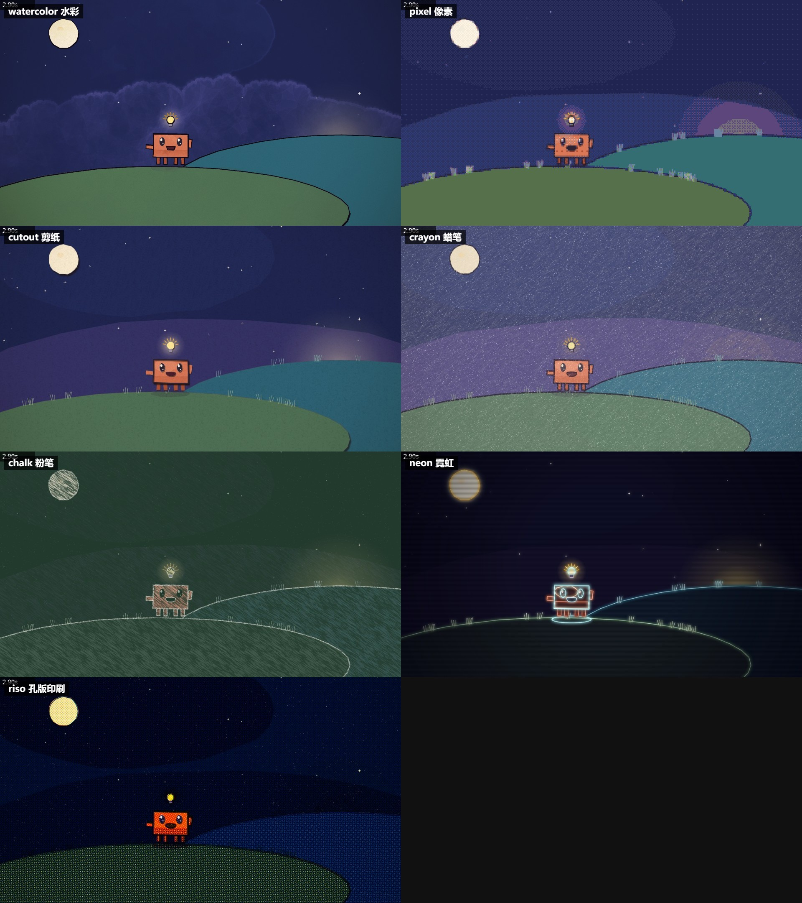

<div align="center">

# animation-styles-skill

<a href="README.md"></a>
<a href="README.zh-CN.md"></a>

**给 Claude 手绘动画技能加上七种画风。**
场景只写一次，可选水彩、像素、剪纸、蜡笔、粉笔、霓虹、孔版印刷。

</div>



## 与原仓库的区别

本仓库基于 tuzhechen2005 的 [opus-video-skills](https://github.com/tuzhechen2005/opus-video-skills)（经由 [Joker-chichi/claude-mv-skill](https://github.com/Joker-chichi/claude-mv-skill)）。原技能**只有水彩一种画风**，本仓库新增了：

- **六种新风格**，与原有的水彩并列，见下表。
- **制作时选风格。** 写分镜前，Claude 用一个问题请你选风格；你已经说了风格的话就不再问。
- **可插拔的风格层。** 场景代码不用改，风格只是 `src/config.js` 里的一行；渲染时加 `--style=` 可以不改配置直接预览别的风格。
- **新风格渲染快得多。** 它们在普通 2D 画布上绘制，约 2–250 毫秒/帧（水彩约 0.3–9 秒/帧），不需要 GPU。
- **支持 Microsoft Edge。** Windows 上没装 Chrome 时会自动使用 Edge。

| 风格 | 效果 | 速度 |
|---|---|---|
| `watercolor` 水彩 | 水彩晕染与抖动墨线（原有，默认） | 慢，需 GPU |
| `pixel` 像素 🆕 | 复古游戏画面：低分辨率网格、有限色板、有序抖动 | 很快 |
| `cutout` 剪纸 🆕 | 剪纸／皮影：彩色卡纸、剪切边缘、投影 | 快 |
| `crayon` 蜡笔 🆕 | 儿童蜡笔画：蜡质笔触、纸张纹理 | 快 |
| `chalk` 粉笔 🆕 | 绿色黑板上的粉笔画 | 快 |
| `neon` 霓虹 🆕 | 暗色世界中的发光灯管、扫描线 | 中等 |
| `riso` 孔版印刷 🆕 | 四色专色油墨半调网点，套色错位 | 快 |

如果只需要水彩风格，用原仓库即可。

## 概述

本技能让 Claude Opus 5.5 独立完成动画视频，涵盖分镜、动画、审查、歌词同步与最终编码。所有画面均由代码程序化生成，不依赖任何图像或视频生成模型。每一帧都由时间唯一确定，在无头 Chrome 或 Edge 中渲染，并由 ffmpeg 编码输出。

### painted-animation


角色依托一套表情库与动画原理进行表演，音乐视频按测得的节拍剪辑，歌词 MV 配有逐字卡拉 OK 字幕。示例为陶喆《小镇姑娘》的 31 秒歌词 MV（水彩风格）。[说明文档](skills/painted-animation/README.zh-CN.md)。

## 环境要求

- Claude Code 及 Claude Opus 5.5
- Node.js、Google Chrome（或 Microsoft Edge）、ffmpeg
- Python 3 及 numpy（仅 painted-animation 的节拍检测需要）

## 安装

**以插件方式安装（推荐）。** 在 Claude Code 中执行：

```
/plugin marketplace add xsong13/animation-styles-skill
/plugin install painted-animation@animation-styles-skill
```

之后用 `/plugin update` 获取新版本。

**以个人技能方式安装。** 克隆仓库一次，再链接所需的技能：

```bash
git clone https://github.com/xsong13/animation-styles-skill ~/animation-styles-skill
ln -s ~/animation-styles-skill/skills/painted-animation ~/.claude/skills/painted-animation
```

之后在 `~/animation-styles-skill` 中执行 `git pull` 即可更新。

## 使用方法

在 Claude Code 中描述所需视频，系统会自动选用匹配的技能，也可以按名称直接调用：

> 制作一段 15 秒的动画：Clawd 试图抓住一只蝴蝶。

写分镜之前，Claude 会用一个问题询问使用七种风格中的哪一种；如果你已经说明了风格，就直接采用。可以一开始就指定：

> 制作一段 15 秒的剪纸风格动画：Clawd 试图抓住一只蝴蝶。

制作音乐 MV 时，请提供歌曲音频和 LRC 歌词文件；创作方向通过一个可留空的自然问题一次问完，不拆成五个问题或五项表单。用户只需回答一句话，也可以不填。技能会创建项目、提交分镜并逐个镜头审查。未经用户明确选择，禁止开始完整渲染；选择本地后禁止云端全量渲染，并提供准确的本地执行命令。

## 目录结构

| 路径 | 说明 |
|---|---|
| `.claude-plugin/marketplace.json` | 插件市场清单 |
| `skills/painted-animation/` | 动画技能：引擎、指南与示例 |
| `skills/painted-animation/template/src/styles/` | 七种风格，每种一个文件 |

## 新增风格

一种风格就是 `skills/painted-animation/template/src/styles/` 下的一个文件，决定 `paint()`、`inkLine()` 和 `glow()` 如何绘制，再把风格名加入 `studio.html` 的 `STYLES` 列表即可。2D 风格基于 `kit2d.js` 实现。每一帧仍须是时间的纯函数。详见 `template/ANIMATION_GUIDE.md` 的 "Styles" 一节。

## 致谢

基础技能、水彩引擎与《小镇姑娘》示例来自 tuzhechen2005 的 [opus-video-skills](https://github.com/tuzhechen2005/opus-video-skills)。风格层和六种新风格是本仓库新增的内容。

painted-animation 的动画引擎与指南改编自 John Heibel 的 [ClaudeAnimationBase](https://github.com/JohnHeibel/ClaudeAnimationBase)（MIT 协议），整体方法参照其 [PDoomVideo](https://github.com/JohnHeibel/PDoomVideo)。本项目使用了 p5.js、p5.brush、Puppeteer 与 ffmpeg。技能及示例由 Claude Opus 5.5 在 Claude Code 中完成。

## 许可协议

MIT，见 [LICENSE](LICENSE)。
